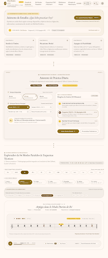
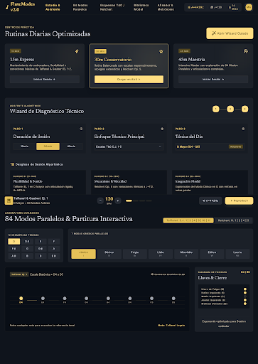
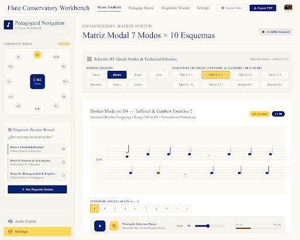
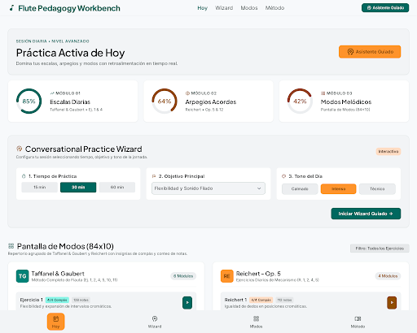

# FluteModes v2.0 — Investigación de Usabilidad (Stitch) y Validación de las 840 Variaciones Modales (Taffanel & Gaubert + Reichert Op. 5)

## 1. Investigación de Usabilidad (Stitch Project `14323574806802443450`)

### 1.1 Diagnóstico de la Pantalla Inicial Actual (`HomeView.swift` / `docs/index.html`)
A partir del feedback de usuarios reales (*«la pantalla inicial es demasiado compleja y las personas no saben qué practicar»*), auditamos el flujo de entrada actual e identificamos tres problemas principales:

1. **Parálisis por Sobrecarga de Opciones (Ley de Hick):**
   La pantalla principal actual expone simultáneamente **12 selectores de método al mismo nivel visual** (`84 Modos`, `E.J. 1`, `E.J. 2`, `E.J. 4`, `E.J. 5`, `E.J. 10`, `E.J. 11`, `R. 1`, `R. 2`, `R. 4`, `R. 5`, `Progreso`), seguidos inmediatamente de los 12 botones de tónica y los 7 botones de modo. Un estudiante que abre la app para estudiar 20 o 30 minutos no recibe orientación sobre **por dónde empezar hoy**.
2. **Falta de Continuidad y Prescripción Guiada (Ausencia de Wizard):**
   El usuario debe decidir manualmente qué combinación de ejercicios armar en cada sesión en lugar de contar con un **Asistente de Práctica (Practice Wizard)** que le pregunte su tiempo disponible y su objetivo técnico del día.
3. **Aislamiento de los 84 Modos Paralelos respecto a los Esquemas Técnicos:**
   Hasta ahora, la vista de **84 Modos Paralelos** sólo permitía tocar el esquema **E.J. 4** (escalas por terceras en `4/2`), impidiendo practicar los modos bajo los demás esquemas fundamentales de **Taffanel & Gaubert (`E.J. 1`, `E.J. 2`, `E.J. 4`, `E.J. 5`, `E.J. 10`, `E.J. 11`)** y **M. A. Reichert Op. 5 (`R. 1`, `R. 2`, `R. 4`, `R. 5`)**.

---

## 2. Las 4 Opciones de UX/UI para Dashboard, Practice Wizard y Pantalla de Modos

Puedes explorar y probar en vivo las 4 opciones en el simulador interactivo:
👉 **[Abrir Portal Interactivo de las 4 Opciones UX (`docs/propuestas_ux_wizard_modos.html`)](file:///Users/sebas/Desktop/partituras/docs/propuestas_ux_wizard_modos.html)**

| Criterio | **Opción 1 (Recomendada): Conservatory Guided Coach** | **Opción 2: Dark Stage Focus Studio** | **Opción 3: Editorial Split-Workbench & Matriz 2D** | **Opción 4: Progressive Mastery Rings & 4-Tab Nav** |
| :--- | :--- | :--- | :--- | :--- |
| **Paleta y Estética** | Pergamino cálido Urtext (`#FDFBF7`), tinta sepia (`#1C1A17`) y oro antiguo (`#D4AF37`). | Obsidiana de concierto (`#0F141C`) y oro champán (`#E5C158`) para atriles con poca luz. | Crema editorial (`#F6F5F0`), índigo real (`#1E3A8A`) y oro (`#D4AF37`). | Alabastro nórdico (`#F8FAFC`), esmeralda (`#0D9488`) y ámbar (`#D97706`). |
| **Dashboard Inicial** | **Hero Coach Card** (*«¿Qué debo practicar hoy?»*) con botón primario al Wizard, tarjeta de **Continuar Última Sesión en 1 toque** y 3 accesos rápidos. | **3 Tarjetas de Rutina por Tiempo** (*15m Express, 30m Conservatorio, 45m Maestría*) en la parte superior sin ruido visual. | **Panel Lateral Izquierdo** con **Rueda Cromática de 12 Tónicas** e indicadores de sesión. | **3 Anillos de Dominio Diario** (*Escalas, Arpegios, Modos*) + navegación inferior dividida en **4 Pestañas** (`Hoy`, `Wizard`, `Modos`, `Método`). |
| **Practice Wizard** | **Modal Guiado de 3 Pasos** (`<dialog closedby="any">`): 1) Tiempo (15/30/45m) → 2) Meta Técnica → 3) Tónica/Modo, generando 3 bloques listos para tocar. | **Bandeja Diagnóstica Inline** desplegable dentro del mismo Dashboard (sin modales superpuestos). | **Diagnóstico Técnico Interactivo** (*¿Qué necesita tu embocadura/dedos hoy?*) integrado en la barra lateral. | **Asistente Conversacional paso a paso** en pestaña dedicada con sugerencia automática de la tónica menos practicada. |
| **Pantalla de Modos (84 × 10)** | Selector limpio de **12 Tónicas** + **7 Modos Paralelos** + **Doble Barra de Chips de Esquema**: Taffanel (`E.J. 1, 2, 4, 5, 10, 11`) y Reichert (`R. 1, 2, 4, 5`). | **Conmutador Segmentado por Tradición** `[Taffanel 1·2·4·5·10·11]` vs `[Reichert 1·2·4·5]` sobre partitura de alto contraste. | **Matriz Bidimensional 7 Modos × 10 Esquemas** para cambiar de celda con un solo clic junto a la partitura. | **Tarjetas Agrupadas por Compás** (`4/2`, `6/8`, `9/8`, `2/4`, `4/4`) con insignias de número de notas y tempo. |
| **Render Stitch** |  |  |  |  |

---

## 3. Nuevas Variaciones de los Ejercicios de Modos (84 Modos × 10 Esquemas = 840 Ejercicios)

Puedes validar visual y auditivamente las 840 variaciones en el portal interactivo:
👉 **[Abrir Laboratorio de Validación de las 840 Variaciones Modales (`docs/modos_variaciones.html`)](file:///Users/sebas/Desktop/partituras/docs/modos_variaciones.html)**

### 3.1 Resumen Musicológico y Estructural de los 10 Esquemas Modales
Cada una de las **12 tónicas cromáticas** (`01_si` a `12_si_bemol`) en sus **7 modos paralelos** (orden pedagógico por familia con armadura fija: **Familia Mayor**: *1. Jónico, 2. Lidio, 3. Mixolidio*; **Familia Menor**: *4. Dórico, 5. Eólico, 6. Frigio, 7. Lócrio*) cuenta ahora con **10 esquemas técnicos completos** construidos sobre los 16 grados diatónicos `s[0..15]` del modo (tesitura estricta `Si3` MIDI 59 a `Do7` MIDI 96):

| # | Código | Esquema Técnico | Tradición / Fuente | Compás | Figura | Compases | Notas Exactas | Articulaciones | Diseño Pedagógico sobre el Modo `s[0..15]` |
| :-: | :--- | :--- | :--- | :-: | :-: | :-: | :-: | :-: | :--- |
| 1 | **`E.J. 1`** | Pentacordios Modales por Grados | Taffanel & Gaubert (Leduc págs. 2–9) | `4/2` | `1/16` | 8 + cierre | **257** | 10 (`a..j`) | Trabaja el pentacordio `[s[d]..s[d+4]..s[d+1]]` (4 pulsos de 8 semicorcheas por compás) ascendiendo grado por grado del modo (`I` a `I'`) con giro final y cierre en `s[7]4`. |
| 2 | **`E.J. 2`** | Pentacordios Modales con Giro en 2 Octavas | Taffanel & Gaubert (Leduc págs. 10–17) | `4/2` | `1/16` | 8 + cierre | **257** | 10 (`a..j`) | Recorre las 2 octavas del modo (`I → III → V → I' → IV' → VI → IV → II/I`) incorporando el giro cadencial de Taffanel `[s[d]..s[d+4], s[d+2], s[d+1], s[d]]` en el 4º pulso y cerrando en `s[0]4`. |
| 3 | **`E.J. 4`** | Escalas Diatónicas Modales por Terceras | Taffanel & Gaubert (Leduc págs. 111–114) | `4/2` | `1/8` | 8 | **127** | 8 (`a..h`) | Esquema canónico de 8 compases en grupos de 8 corcheas ascendiendo y descendiendo por terceras diatónicas a través de 2 octavas (`s[0..14]`). |
| 4 | **`E.J. 5`** | Escalas Modales Continuas en 6/8 | Taffanel & Gaubert (Leduc pág. 115) | `6/8` | `1/16` | 4 + cierre | **49** | 10 (`a..j`) | Movimiento 100% conjunto sin saltos (`|Δgrado| = 1` en las 48 semicorcheas): asciende de `s[0]` a `s[14]`, desciende al pivote de dominante `s[4]`, vuelve a la cumbre `s[14]` y desciende a `s[0]4`. |
| 5 | **`E.J. 10`** | Arpegios Modales Diatónicos en 6/8 | Taffanel & Gaubert (Leduc págs. 120–121) | `6/8` | `1/16` | 8 + cierre | **97** | 10 (`a..j`) | Arpegia los 7 acordes diatónicos de cada modo (`I, II, III, IV, V, VI, VII, I`) en 2 octavas siguiendo la fórmula exacta `[a1,a2,a3,a4,a5,a6, a7,a6,a5,a4,a3,a2]` + cierre en `s[0]4`. |
| 6 | **`E.J. 11`** | Arpegios Quebrados (*Arpèges Brisés*) en 9/8 | Taffanel & Gaubert (Leduc págs. 122–125) | `9/8` | `1/16` | 8 + cierre | **145** | 10 (`a..j`) | Aplica la fórmula quebrada de 18 semicorcheas por compás `[a1,a3,a2,a4,a3,a5][a4,a6,a5,a7,a5,a6][a4,a5,a3,a4,a2,a3]` sobre los 7 acordes del modo + cierre en `s[0]6`. |
| 7 | **`R. 1`** | Reichert Op. 5 Nº 1 Modal en 6/8 | M. A. Reichert (Schott 20623 págs. 2–3) | `6/8` | `1/16` | 4 | **43** | 10 (`a..j`) | Adapta nota por nota el contorno de Reichert Nº 1 a los grados `s[0..14]` del modo, culminando con el arpegio de 2 octavas `s[0]-s[2]-s[4]-s[7]-s[9]-s[11]-.s[14]2`. |
| 8 | **`R. 2`** | Reichert Op. 5 Nº 2 Modal en 2/4 | M. A. Reichert (Schott 20623 págs. 4–5) | `2/4` | `1/16` | Anacrusa + 8 | **61** | 8 (`a..h`) | Anacrusa `(s[0]s[2]s[4]s[7])` seguida de 7 compases alternando el acorde de sensible/subtónica modal con el acorde de tónica modal en 2 octavas y cierre en `.s[7]2`. |
| 9 | **`R. 4`** | Reichert Op. 5 Nº 4 Modal en 4/4 | M. A. Reichert (Schott 20623 págs. 8–9) | `C` | `1/16` | 4 | **61** | 8 (`a..h`) | Arpegios modales con bordaduras diatónicas superiores e inferiores propias de los semitonos característicos de cada modo, cerrando en `.s[0]2`. |
| 10 | **`R. 5`** | Reichert Op. 5 Nº 5 Modal en 2/4 Tresillos | M. A. Reichert (Schott 20623 págs. 10–13) | `2/4` | `1/16` | 8 | **91** | 10 (`a..j`) | Tresillos de semicorchea con grandes intervalos ligados entre bajos modales (`s[4], s[6], s[5], s[3]`) y picos agudos (`s[14], s[13], s[15]`), resolviendo en `.s[7]2`. |

---

### 3.2 Archivos ABC Maestros Generados para Validación
- [00_Coleccion_84_Modos_EJ1.abc](file:///Users/sebas/Desktop/partituras/00_Coleccion_84_Modos_EJ1.abc) — 84 Modos en **Taffanel E.J. 1**
- [00_Coleccion_84_Modos_EJ2.abc](file:///Users/sebas/Desktop/partituras/00_Coleccion_84_Modos_EJ2.abc) — 84 Modos en **Taffanel E.J. 2**
- [00_Coleccion_84_Modos_EJ4.abc](file:///Users/sebas/Desktop/partituras/00_Coleccion_84_Modos_EJ4.abc) — 84 Modos en **Taffanel E.J. 4**
- [00_Coleccion_84_Modos_EJ5.abc](file:///Users/sebas/Desktop/partituras/00_Coleccion_84_Modos_EJ5.abc) — 84 Modos en **Taffanel E.J. 5**
- [00_Coleccion_84_Modos_EJ10.abc](file:///Users/sebas/Desktop/partituras/00_Coleccion_84_Modos_EJ10.abc) — 84 Modos en **Taffanel E.J. 10**
- [00_Coleccion_84_Modos_EJ11.abc](file:///Users/sebas/Desktop/partituras/00_Coleccion_84_Modos_EJ11.abc) — 84 Modos en **Taffanel E.J. 11**
- [00_Coleccion_84_Modos_R1.abc](file:///Users/sebas/Desktop/partituras/00_Coleccion_84_Modos_R1.abc) — 84 Modos en **Reichert Op. 5 Nº 1**
- [00_Coleccion_84_Modos_R2.abc](file:///Users/sebas/Desktop/partituras/00_Coleccion_84_Modos_R2.abc) — 84 Modos en **Reichert Op. 5 Nº 2**
- [00_Coleccion_84_Modos_R4.abc](file:///Users/sebas/Desktop/partituras/00_Coleccion_84_Modos_R4.abc) — 84 Modos en **Reichert Op. 5 Nº 4**
- [00_Coleccion_84_Modos_R5.abc](file:///Users/sebas/Desktop/partituras/00_Coleccion_84_Modos_R5.abc) — 84 Modos en **Reichert Op. 5 Nº 5**
- Más los **120 archivos individuales por tónica y esquema** en [abc_modos_variaciones/](file:///Users/sebas/Desktop/partituras/abc_modos_variaciones).
